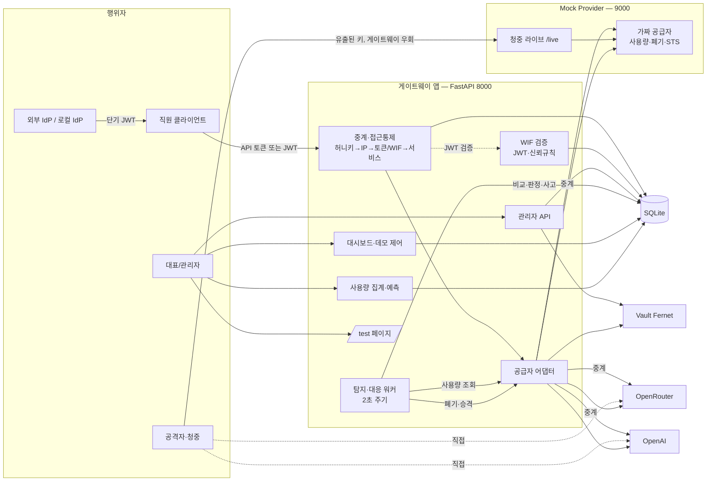
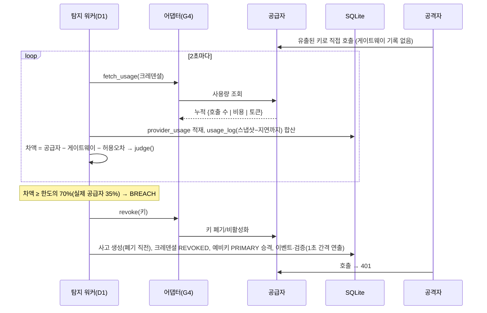

# 소프트웨어 아키텍처 설명 (다이어그램 작성용)

이 문서는 아키텍처 그림(컴포넌트도·시퀀스도·배포도)을 그리는 사람이 그대로 옮겨 그릴 수 있도록 구성요소, 연결, 신뢰 경계, 데이터 흐름을 정리한 것이다. 구현 현황 기준이며 해커톤 PoC 범위다.

## 1. 한 줄 요약
기업의 모든 AI API 호출을 하나의 게이트웨이로 모으고, **게이트웨이가 기록한 호출 수와 공급자가 보고한 사용량을 비교**해 키 유출(무단 사용)을 탐지하며, 탐지 즉시 그 키를 폐기하고 예비키로 전환한다.

## 2. 컴포넌트 목록 (그림의 박스)
### 2-1. 사용자·외부 행위자
| ID | 이름 | 설명 |
|---|---|---|
| U1 | 직원 클라이언트 | 직원 PC·서비스. OpenAI 호환 API로 게이트웨이를 호출. 공급자 키를 모름 |
| U2 | 대표(관리자) | 대시보드·테스트 페이지로 크레덴셜·한도·허용 IP·토큰을 관리(대표 대시보드 화면은 미구현, 현재는 `/test`) |
| U3 | 공격자 / 청중 | 유출된 키로 **공급자에 직접** 호출(게이트웨이 우회) |
| U4 | 외부 IdP (OIDC) | GitHub Actions·Google·Entra 등. 직원 서비스에 단기 JWT 발급(WIF). PoC는 로컬 가짜 IdP |

### 2-2. 게이트웨이 앱 (FastAPI, 한 프로세스, 포트 8000/8800)
| ID | 모듈 | 책임 |
|---|---|---|
| G1 | `gateway/router.py` — **중계·접근통제** | `/v1/chat/completions` OpenAI 호환 중계. 검사 순서: 허니키 일치 → 허니키 IP 임시 차단 → 출발 IP(허용 CIDR) → WIF JWT 또는 API 토큰 → 서비스 상태 → PRIMARY 크레덴셜 존재. 거부 로그 기록(허니키는 별도 `honeykey_event`) |
| G2 | `gateway/router.py` — **관리자 API** | 크레덴셜·CIDR·서비스(정지/재개)·토큰·설정·허니키 목록·거부 로그, 실제 공급자 키 프로비저닝(`/admin/{provider}/provision`) (`/admin/*`, X-Admin-Key) |
| G3 | `wif_inbound.py` — **직원 측 WIF** | RS256 JWT 검증(서명·만료·audience·issuer), 신뢰 규칙(issuer+subject 패턴→서비스), 로컬 데모 IdP(`/idp/*`) |
| G4 | `providers.py` — **공급자 어댑터** | mock / openrouter / openai 어댑터. `fetch_usage`(키별 누적: 호출 수·토큰·비용 중 있는 값), `revoke`, 응답 비용 추출, 지연(`lag_s`) |
| D1 | `detector/router.py` — **탐지·대응 워커** | 2초마다 공급자 사용량 조회 → 게이트웨이 기록과 시점 정렬 비교 → 판정(NORMAL/SUSPECT/WARNING/BREACH) → 자동 대응 |
| D2 | `detector/router.py` — **대시보드 API·데모 제어** | 상태·차액·시계열·사고·이벤트 조회, 공격 시뮬레이터(Mock 전용), 리셋(`/demo/reset`, `/demo/reset-openrouter`·`-openai`), 정리(`/demo/cleanup-*`), 허니키 호출 |
| U5 | `usage.py` + `pricing.py` — **사용량 집계·예측** | 서비스별 토큰·비용 집계, 모델별 단가표 기반 예상 비용, 선형 월말 예측, 월 예산 |
| T1 | `testpage.py` + `static/test.html` | 디자인 없는 기능 테스트 페이지 `/test` |
| C1 | `contract.py`, `db.py`, `vault.py` | 공용 상수·판정 함수·`.env` 로드 / SQLite 스키마 / API Key 암호화(Fernet) |
| C2 | `clientip.py` | 관리자 키 비교, 출발 IP 결정(신뢰 프록시 XFF·`X-Demo-Source-IP`), 공개 모드 가드(`/demo/*`·`/idp/token`). 게이트웨이·Mock 공용 |
| C3 | `main.py` | 앱 조립(라우터 5개 등록, CORS 전체 허용, 시작 시 `init_db`·워커 기동) |

### 2-3. 별도 서비스
| ID | 이름 | 설명 |
|---|---|---|
| M1 | **Mock Provider** (FastAPI, 포트 9000/9800) | OpenAI 호환 가짜 공급자: 키 검증·폐기·사용량 집계(2초 지연)·STS(WIF 단기 토큰). 선택적으로 실제 업스트림 패스스루 |
| M2 | **청중 라이브** `/live/*` (M1에 포함) | 청중 채팅 페이지, `/live/chat`(속도 제한·토큰 상한), `/live/stats`, 키 상태 |

### 2-4. 저장소
| ID | 이름 | 내용 |
|---|---|---|
| S1 | SQLite (`gateway.db`) | setting, allowed_cidr, service, gateway_token(해시), credential(암호문·마스킹), usage_log, provider_usage, access_denied_log, incident, event, honeykey, honeykey_event, trusted_identity |
| S2 | Vault (프로세스 내 Fernet) | API Key 암호화·복호화. 운영에서는 KMS/Secrets Manager로 교체 |

### 2-5. 외부 AI 공급자
| ID | 이름 | 사용량 조회 | 키 폐기 | 반영 지연(실측) |
|---|---|---|---|---|
| P1 | Mock | `/usage` | `/revoke` | 2초 / 즉시(어댑터 값 0.5초) |
| P2 | OpenRouter | `GET /keys/{hash}` 사용액(USD) | `PATCH disabled` | 약 6초 / 약 20초 (호출 수 API는 당일 미지원) |
| P3 | OpenAI | Usage API `num_model_requests` 1분 버킷 | 서비스 계정 삭제 | 수 분(381초 실측, 이후 측정 미확인) / 약 3초 |

## 3. 컴포넌트 다이어그램 (Mermaid)

## 4. 핵심 시퀀스
### 4-1. 정상 호출
1. 직원이 `Authorization: Bearer <API 토큰 또는 JWT>`로 `POST /v1/chat/completions`.
2. G1: 허니키 아님? → 허니키로 차단된 IP 아님? → 출발 IP ∈ 허용 CIDR? → G3가 JWT 검증 또는 토큰 해시 일치 → 서비스 ACTIVE?
3. 현재 `PRIMARY ACTIVE` 크레덴셜 선택, S2에서 키 복호화(WIF 크레덴셜은 STS 단기 토큰) → 공급자로 중계, 스트리밍 포함.
4. 응답이 200이고 `usage`(또는 비용)가 있으면 `usage_log` 1행 기록 → 응답 반환(업스트림 401·네트워크 오류는 502).

### 4-2. 탐지와 자동 대응

- 판정: 한도(허용 무단 호출 수, 기본 100)의 10% SUSPECT / 50% WARNING / 70% BREACH. 공급자 지연이 큰 경우(OpenRouter·OpenAI) 비율을 5% / 20% / 35%로 낮춘다(`contract.RATIOS`).
- 안전 경로: 공급자 값이 게이트웨이 **전체** 기록을 넘으면 확실한 유출(정상 호출은 항상 게이트웨이에 먼저 기록되므로 오탐 없음).
- 비용만 주는 공급자는 비용 차이로 비교하고 호출 수를 평균 호출 비용으로 추정한다(`calls_estimated`).
- 분 버킷을 주는 공급자(OpenAI)는 반영이 끝난 버킷 경계까지 누적 비교.

### 4-3. 직원 측 WIF
1. 직원 서비스가 IdP에서 단기 JWT(RS256)를 받는다.
2. 게이트웨이(G3)가 JWKS로 서명, `exp`, `aud`, `iss`를 검증하고 `sub`가 신뢰 규칙에 맞는지 확인 → 서비스로 매핑.
3. 이후는 4-1의 3~4단계와 동일.

### 4-4. 허니키
게이트웨이에 심어 둔 가짜 토큰으로 접근 → 호출자에게는 평범한 401, 내부에서 `honeykey_event`·사고(HONEYKEY)·출발 IP 10분 임시 차단.

### 4-5. 청중 라이브
청중 폰 → `/live`(M2) → `/live/chat`이 유출 키로 공급자에 호출 → 탐지 워커가 차이를 감지해 키 폐기 → 청중 화면에 401/"차단되었습니다".

## 5. 신뢰 경계 (그림에서 점선 영역)
1. **인터넷 ↔ NPM(hack.sio2.kr)**: 공개 영역. 공개 모드에서 `/demo/*`·`/admin/*`·`/idp/token`은 관리자 키 필요, `/docs` 비활성.
2. **NPM ↔ 게이트웨이(Tailscale)**: 신뢰 프록시. `X-Forwarded-For`는 신뢰 프록시일 때만 인정.
3. **게이트웨이 ↔ 공급자**: 실제 키는 Vault에만 존재. 직원은 키를 보지 못한다.
4. **공격자 ↔ 공급자**: 게이트웨이를 통과하지 않는 경로. 이 경로가 사용량 대조의 탐지 대상이다.

## 6. 배포 구조
- **로컬 개발**: Mock 9000 + 게이트웨이 8000, SQLite 파일, `scripts/dev.ps1`.
- **테스트 서버(`hack.sio2.kr`)**: 이 PC에서 게이트웨이 8800·Mock 9800을 Tailscale IP로 바인드 → Nginx Proxy Manager(Tailscale 노드)가 `hack.sio2.kr`를 이 PC로 프록시하고 `/live`만 9800으로 라우팅. 인증서는 `*.sio2.kr`.
- 환경변수: `PUBLIC_MODE`, `ADMIN_KEY`, `TRUSTED_PROXIES`, `DEMO_MODE`(기본 1, 로컬 IdP·`X-Demo-Source-IP`), `MOCK_BASE_URL`, `DB_PATH`, `VAULT_KEY`, `LEAKED_KEY`, `IDP_ISSUER`, `UPSTREAM_API_KEY`·`UPSTREAM_BASE_URL`(Mock 실제 AI 패스스루), `LIVE_MODEL`, `OPENROUTER_MANAGEMENT_KEY`, `OPENAI_ADMIN_KEY`·`OPENAI_PROJECT_ID`. 테스트 서버는 실제 키 3종(`UPSTREAM_API_KEY`·`OPENROUTER_MANAGEMENT_KEY`·`OPENAI_ADMIN_KEY`)을 지운 채 실행한다(Mock만).

## 7. 그림 작성 가이드
- **레이어**: 행위자 → (NPM) → 게이트웨이 앱(중계·탐지·관리) → 어댑터 → 공급자, 좌우로 저장소(SQLite·Vault)를 둔다.
- **화살표 색 구분 권장**: 정상 호출(실선), 탐지 조회(파선), 공격 경로(빨강), 자동 폐기(굵은 선).
- **강조할 것**: ① 공격자 경로가 게이트웨이를 우회한다 ② 탐지 워커가 공급자 값과 게이트웨이 기록을 **서로 다른 경로로** 얻어 비교한다 ③ 폐기·승격 후에도 직원 경로는 끊기지 않는다.

## 8. 한계와 운영 전환
| PoC | 운영 |
|---|---|
| SQLite | Postgres 등 외부 DB, 이중화 |
| Fernet 키를 환경변수로 | KMS / Secrets Manager |
| 단일 프로세스 워커 | 별도 워커·큐, 공급자별 폴링 격리 |
| Mock/로컬 IdP | 실제 IdP(JWKS 캐시·키 교체) |
| 고정 관리자 키 | SSO·역할 기반 접근 |
| 공급자 지연만큼 탐지 지연 | 공급자 한도·알림과 병행, 지연을 사용자에게 명시 |
- 게이트웨이 자체가 침해되면 Vault 키까지 노출될 수 있다(허니키로 침해 시도를 탐지하는 보완).
