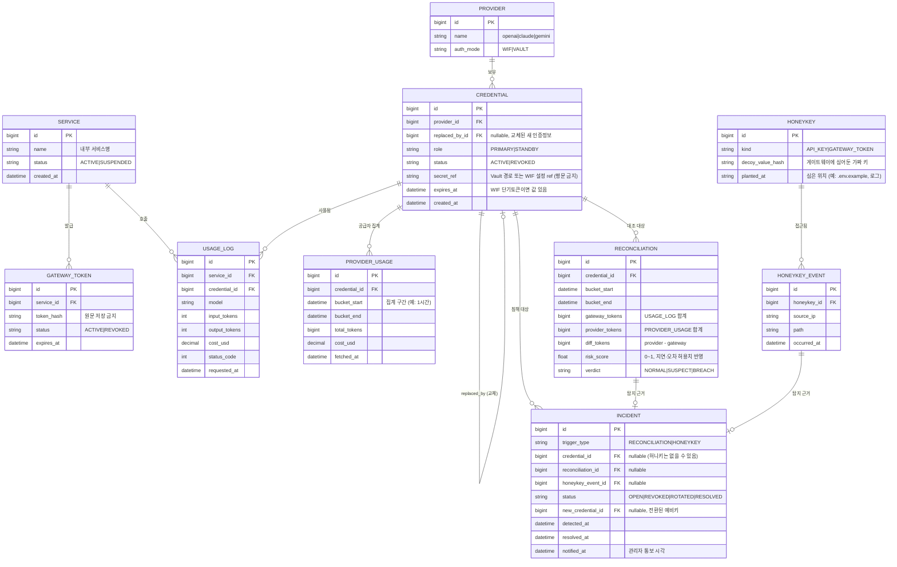

# AI Gateway ERD (해커톤 데모용)

## 설계 메모
- **탐지 흐름**: `USAGE_LOG`(게이트웨이 기록) vs `PROVIDER_USAGE`(공급자 조회) → `RECONCILIATION`에서 구간별 대조 → `verdict=BREACH`면 `INCIDENT` 생성.
- **자동 대응**: `INCIDENT`가 `CREDENTIAL`을 `REVOKED`로 바꾸고, `role=STANDBY`인 키를 `PRIMARY`로 승격 (`replaced_by_id` / `new_credential_id` 기록).
- **WIF vs Vault**: `PROVIDER.auth_mode`로 구분. WIF는 `expires_at`이 있는 단기 토큰, Vault는 `secret_ref`만 저장 — 키 원문은 DB에 없다.
- **허니키**: 게이트웨이 자체 공격 탐지용. `HONEYKEY_EVENT`가 한 건이라도 생기면 즉시 `INCIDENT`(trigger=HONEYKEY).
- **생략(YAGNI)**: 관리자/사용자 테이블, 알림 채널 테이블, 프로젝트·팀 계층. 필요하면 `INCIDENT.notified_at`을 알림 테이블로 분리.
