# AI Gateway ERD (해커톤 데모용)

```mermaid
erDiagram
    SERVICE ||--o{ GATEWAY_TOKEN : "발급"
    SERVICE ||--o{ USAGE_LOG : "호출"
    CREDENTIAL ||--o| CREDENTIAL : "replaced_by_id (교체)"
    CREDENTIAL ||--o{ USAGE_LOG : "사용됨"
    CREDENTIAL ||--o{ PROVIDER_USAGE : "공급자 누적 스냅샷"
    CREDENTIAL ||--o{ INCIDENT : "침해 대상 (HONEYKEY는 NULL)"
    CREDENTIAL ||--o| INCIDENT : "new_credential_id (승격된 예비키)"
    HONEYKEY ||--o{ HONEYKEY_EVENT : "접근됨"

    SETTING {
        string key PK "loss_limit_krw 등"
        string value
    }
    ALLOWED_CIDR {
        int id PK
        string cidr
        string label "INTERNAL|VPN"
    }
    SERVICE {
        int id PK
        string name
        string status "ACTIVE|SUSPENDED"
    }
    GATEWAY_TOKEN {
        int id PK
        int service_id FK
        string token_hash UK "SHA-256, 원문 저장 금지"
        string token_masked
        string status "ACTIVE|REVOKED"
        string created_at
    }
    CREDENTIAL {
        int id PK
        string provider "문자열 (예: mock). PROVIDER 테이블 없음"
        string auth_mode "API_KEY|WIF"
        string role "PRIMARY|STANDBY"
        string status "ACTIVE|REVOKED"
        string secret_enc "API_KEY: vault 암호문, WIF: NULL"
        string masked
        string audience "WIF 전용"
        string provider_ref "공급자 사용량/폐기 식별자"
        int replaced_by_id FK "nullable"
        string created_at
    }
    USAGE_LOG {
        int id PK
        int service_id FK
        int credential_id FK
        string model
        int input_tokens
        int output_tokens
        real cost_krw
        int status_code
        real at "epoch 초"
    }
    PROVIDER_USAGE {
        int id PK
        int credential_id FK
        real cost_krw "누적값 스냅샷"
        int tokens
        real at
    }
    ACCESS_DENIED_LOG {
        int id PK
        string source_ip
        string reason "ip_not_allowed|invalid_token|service_suspended"
        string token_masked
        real at
    }
    INCIDENT {
        int id PK
        int credential_id FK "nullable (HONEYKEY)"
        string trigger_type "RECONCILIATION|HONEYKEY"
        string status "OPEN|ROTATED|RESOLVED"
        real detected_at
        real blocked_at
        real resolved_at
        real loss_krw
        real limit_krw
        int new_credential_id FK "nullable"
        string timeline "JSON [{at,step,detail,ok}]"
    }
    HONEYKEY {
        int id PK
        string value_hash UK
        string masked
        string planted_at "심은 위치 설명"
        string created_at
    }
    HONEYKEY_EVENT {
        int id PK
        int honeykey_id FK
        string source_ip
        string path
        real at
    }
    EVENT {
        int id PK
        real at
        string kind "SUSPECT|WARNING|BLOCKED|RECOVERED|ATTACK_STARTED|ATTACK_STOPPED|ACCESS_DENIED|HONEYKEY"
        string message
        string data "JSON, nullable"
    }
```

원본은 `app/db.py`의 `SCHEMA`. SETTING·ALLOWED_CIDR·ACCESS_DENIED_LOG·EVENT는 FK 없는 독립 테이블이라 관계선을 생략했다. 시간 컬럼은 `at`류는 epoch 초(real), `created_at`류는 ISO 문자열.

## 설계 메모
- **PROVIDER 테이블 없음**: 공급자는 `credential.provider` 문자열(PoC는 `mock`). 인증 방식은 `credential.auth_mode`(API_KEY|WIF).
- **RECONCILIATION 테이블 없음**: 대조는 워커가 `usage_log` 합 vs 최신 `provider_usage`로 매 틱 계산(`effective_diff`/`judge`). 결과는 `event`와 `incident`로만 남는다.
- **탐지 흐름**: BREACH → `incident` 생성(credential당 1개) → 공급자 폐기 → `credential` REVOKED + STANDBY를 PRIMARY 승격(`replaced_by_id`, `new_credential_id`).
- **허니키**: `honeykey_event` 발생 시 `incident(trigger_type=HONEYKEY, credential_id=NULL)`와 `event(HONEYKEY)` 기록.
- **키 원문**: API_KEY는 `secret_enc`(vault 암호문)만 저장, WIF는 `secret_enc`가 없고 단기 토큰을 Mock STS에서 발급.
