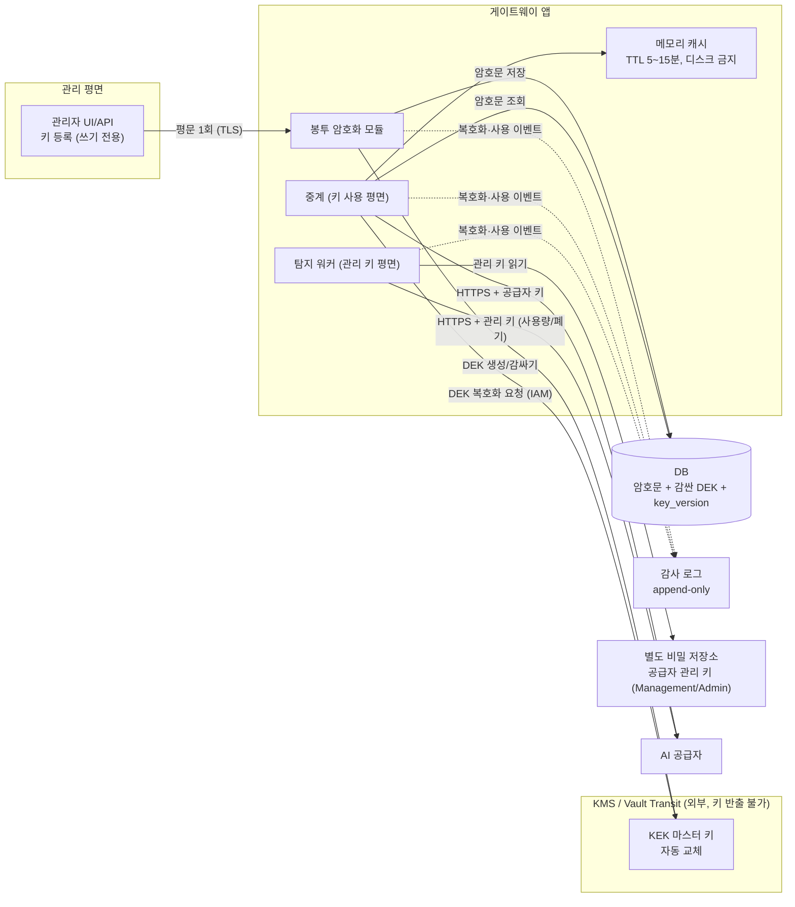

# 공급자 API 키 안전 보관 설계

게이트웨이가 OpenAI·OpenRouter 같은 **AI 공급자의 API 키**를 보관·사용·교체할 때의 설계다. 목표는 ① 키가 평문으로 저장되지 않는다 ② 한 곳이 뚫려도 피해가 키 전체로 번지지 않는다 ③ 키를 쓰는 모든 순간이 기록된다 ④ 유출이 의심되면 즉시 교체한다.

## 1. 위협 모델
| 위협 | 예 | 막는 장치 |
|---|---|---|
| DB·백업 유출 | `gateway.db` 파일 복사, 백업 탈취 | 키는 **암호문만** 저장, 암호화 키(KEK)는 DB와 다른 곳(KMS) |
| 호스트 침해 | 게이트웨이 서버에서 셸 획득 | 키 사용 권한 분리, 짧은 수명 키, 사용 감사·이상 탐지 |
| 내부자·관리자 | 관리자 계정이 키를 읽음 | **쓰기 전용 등록**(읽기 API 없음), 마스킹 표시만, 접근 감사 |
| 로그·화면 노출 | 로그에 키 출력, 오류 메시지 | 키 값 로깅 금지, 응답엔 마스킹만 |
| 소스 저장소 노출 | `.env`·기본 키 커밋 | 기본 키 상수 금지, 비밀 스캔(CI), `.gitignore` |
| 메모리 덤프 | 프로세스 메모리 | 평문은 사용 순간에만 짧게 보유, 캐시 TTL |
| 공급자 측 키 유출(이 시스템의 대상) | 개발자 PC·저장소에서 키 유출 | 사용량 대조 탐지 → 자동 폐기·예비키 승격 |

## 2. 설계 원칙
1. **WIF 우선**: 공급자가 지원하면 장기 키를 아예 저장하지 않고 단기 토큰만 쓴다(키를 훔칠 대상이 없다).
2. **키가 필요하면 봉투 암호화(Envelope Encryption)**: 키마다 데이터 키(DEK)로 암호화하고, DEK는 KMS의 마스터 키(KEK)로 감싼다.
3. **최소 권한·평면 분리**: 등록(관리) / 사용(중계) / 탐지(관리 키) 권한을 서로 다른 신원으로 나눈다.
4. **읽기 불가 등록**: 키는 넣을 수만 있고 꺼내 볼 수 없다. 화면과 API는 마스킹(`sk-...a9f2`)만.
5. **짧게 쓰고 자주 바꾼다**: 사용 시점에만 복호화, 정기 교체 + 유출 의심 시 즉시 교체(예비키 승격은 이미 구현).
6. **모든 사용을 기록한다**: 누가·언제·어떤 크레덴셜을 복호화했는지(값은 제외).

## 3. 키 계층과 저장 구조

- **KEK**(마스터 키): KMS/HSM 안에서만 존재, 앱은 "감싸기/풀기"만 호출한다. 자동 교체(예: 연 1회)해도 DEK 재감싸기만 하면 된다.
- **DEK**(키별 데이터 키): 크레덴셜마다 새로 만든다. AES-256-GCM으로 공급자 키를 암호화하고, **암호화 컨텍스트**(`credential_id`+`provider`)를 묶어 암호문을 다른 행으로 옮겨 붙이는 공격을 막는다.
- **DB 저장 항목**: `secret_ciphertext`, `wrapped_dek`, `kek_id`, `key_version`, `masked`. 평문 키·키 해시 외 식별자는 저장하지 않는다.
- **공급자 관리 키**(OpenRouter Management, OpenAI Admin)는 폐기·생성까지 가능한 **가장 강한 키**다. 일반 키와 **다른 KEK·다른 저장소·탐지 워커 전용 신원**에 두고, 중계 프로세스는 읽지 못하게 한다.

### 3-1. 권장 구성: HashiCorp Vault + AWS KMS
- **Vault가 공급자 키를 보관**한다. KV v2(버전·삭제 이력)에 `tenant/provider/credential` 경로로 저장하고, DB에는 **경로(`secret_ref`)와 메타데이터만** 둔다(평문·암호문 모두 DB에 없음). 필요하면 Transit으로 앱이 암호화 서비스를 호출하게 해 키 자체를 앱이 보지 않게 한다.
- **AWS KMS가 Vault 마스터 키를 보호**한다(자동 언실). 사람이 언실 키를 다루지 않고, 마스터 키는 KMS 밖으로 나가지 않는다.
- **인증과 정책**: 게이트웨이 서버는 **AppRole**(RoleID + SecretID, 단기 토큰)로 로그인한다. 평면별 정책을 분리한다: **등록(관리 평면) = 쓰기 전용**, **사용(중계 평면) = 읽기**, **탐지 워커 = 관리 키 경로만 읽기**. 서로의 경로는 읽지 못한다.
- **동적 시크릿(가능한 공급자)**: 공급자가 키 발급 API를 제공하면(OpenRouter 키 생성, OpenAI 서비스 계정) Vault가 단기 키를 발급·갱신·폐기(리스 TTL)하게 해 장기 키 보관을 줄인다.
- **감사**: Vault 감사 장치가 모든 읽기·쓰기를 기록하고 게이트웨이 감사 로그와 함께 append-only 저장소로 보낸다(키 값은 기록되지 않는다).
- **소규모·Vault 미사용 대안**: Vault를 운영하기 어려우면 3절의 KMS 봉투 암호화(DEK/KEK)로 DB 암호문을 보호한다.

## 4. 저장 방식 비교
| 방식 | 설명 | 장점 | 한계 | 단계 |
|---|---|---|---|---|
| **A. Fernet + 환경변수 키** | 앱 프로세스가 환경변수 키로 암호화(현재) | 구현 단순 | 키와 암호문이 같은 호스트, 감사·교체 없음 | 해커톤 PoC |
| **B. 봉투 암호화 + KMS** | 위 3절 구조 | 키 반출 불가, 감사 가능, 자동 교체 | KMS 의존, 호출 지연 | **운영 기본** |
| **C. Vault/Secrets Manager 동적 키** | 필요할 때 공급자에 단기 키를 발급(JIT), TTL 후 자동 폐기 | 장기 키가 없다 | 공급자가 키 발급 API 지원 필요(OpenRouter·OpenAI 서비스 계정은 가능) | 운영 고도화 |
| **D. WIF** | 단기 토큰만 | 저장할 비밀 없음 | 공급자 지원 필요 | 가능하면 최우선 |

## 5. 런타임 규칙
- 복호화는 **사용 순간**에만 한다. 결과는 프로세스 메모리 캐시에 TTL(5~15분)로만 두고 디스크·로그·예외 메시지에 쓰지 않는다. 교체·폐기 이벤트가 오면 캐시를 즉시 비운다.
- 키를 명령행 인자·URL·쿼리에 넣지 않는다(헤더로만). 환경변수에 평문 키를 두지 않는다.
- 시크릿 파일은 권한 600, 소유 서비스 계정만. 서비스는 비특권 사용자로 실행.
- 응답·로그에는 마스킹(`앞3자...뒤4자`)과 `credential_id`만 남긴다.
- **유출 의심 시 순서**: 공급자에서 폐기 → 예비키 승격 → 사고 기록 → 폐기된 암호문 삭제(또는 `REVOKED`로 잠금). 이 흐름은 현재 구현된 자동 대응과 같다.

## 6. 교체·비상 절차
- **정기 교체**: 예비키를 주 키로 승격 → 새 예비키 생성 → 옛 키 폐기. 주기 예: 30일.
- **KEK 교체**: KMS 자동 교체, DEK를 새 KEK로 다시 감싼다(공급자 키 자체는 그대로).
- **비상(Break-glass)**: 게이트웨이 침해가 의심되면 모든 공급자 키를 일괄 폐기하는 절차를 문서화하고 분기별로 훈련한다.

## 7. 감사와 탐지
- **감사 로그**: 키 등록·복호화·사용·폐기·교체 이벤트(시각, 행위자 신원, `credential_id`, 결과). append-only 저장소로 보낸다.
- **허니 크레덴셜**: 보관소에 가짜 공급자 키를 심어 두고, 그 키가 쓰이면 즉시 경보(게이트웨이의 허니키와 같은 발상).
- **비밀 스캔**: 저장소·CI에서 키 패턴 탐지(`sk-`, `sk-or-` 등).
- **사용량 대조**(이 시스템의 핵심): 위 보호가 뚫려 키가 새도 공급자 사용량과 게이트웨이 기록의 차이로 탐지해 폐기한다. 키 보관은 "새지 않게", 대조는 "새도 빨리 막게"를 맡는 두 겹의 방어다.

## 8. 현재 PoC 구현과의 격차 (솔직한 현황)
`app/vault.py`는 Fernet(AES-128-CBC + HMAC-SHA256)이다. 아래는 코드·서버 확인 결과다.

| # | 격차 | 영향 | 개선 |
|---|---|---|---|
| 1 | **`VAULT_KEY` 환경변수가 없으면 코드의 고정 문자열(`november-demo-vault`)로 키를 만든다.** 배포 서버에 `VAULT_KEY`가 설정되어 있지 않아 이 기본값이 쓰인다 | 공개 저장소를 아는 사람은 DB만 얻으면 암호문을 풀 수 있다 | 기본값 제거(미설정 시 기동 거부), 무작위 키를 비밀 저장소에서 주입 |
| 2 | **`credential.provider_ref`에 API 키 원문이 그대로 저장된다**(Mock·vLLM의 API_KEY는 키 문자열이 곧 공급자 쪽 식별자) | 암호화 컬럼이 있어도 같은 DB에 평문이 남아 암호화가 무력화된다 | 공급자 쪽 식별자를 키의 **SHA-256 해시**로 바꾸고(공급자 인터페이스가 해시를 owner로 받게 변경), 원문 컬럼 제거 |
| 3 | DB 파일 권한 644, 암호화 키와 같은 호스트 | 같은 호스트의 다른 프로세스·사용자가 읽을 수 있다 | 600, 전용 사용자, KEK는 외부 KMS |
| 4 | 암호화 컨텍스트 없음, 키 버전·교체 이력 없음 | 암호문 바꿔치기와 키 교체 추적 불가 | `key_version`, `kek_id`, 컨텍스트 바인딩 |
| 5 | 복호화·사용 감사 로그 없음 | 누가 언제 키를 썼는지 알 수 없다 | 감사 이벤트 추가 |
| 6 | 공급자 관리 키(Management/Admin)를 환경변수로 보관, 중계와 같은 프로세스 | 중계가 뚫리면 키 생성·삭제 권한까지 노출 | 탐지 워커를 별도 프로세스·신원으로 분리 |
| 7 | 관리자 키가 고정값 `admin`, `/demo/*` 응답에 유출 키 포함(데모용) | 공개 서버에서 추측 가능 | 운영에서는 SSO·역할 기반, 데모 응답 제거 |
| 8 | 정기 교체 일정·비상 절차 없음 | 사고 대응 의존 | 6절 절차 적용 |

> 키가 사람·팀 단위로 늘어나는 B2B 구조(테넌트별 KEK, 인당 1키, 예비 키 풀)는 `docs/multi-key-management-design.md` 참조.

## 9. 단계별 로드맵
| 단계 | 내용 | 효과 |
|---|---|---|
| **P1 (즉시, 코드 수정 작음)** | `VAULT_KEY` 기본값 제거·기동 시 필수화, `provider_ref` 원문 제거(해시), DB·환경파일 권한 600, 키 값 로깅 금지 점검 | 격차 1~3 해소 |
| P2 | `vault.py`를 교체 가능한 인터페이스(`encrypt(plain, context)` / `decrypt(enc, context)`)로 바꾸고 KMS 봉투 암호화 백엔드 추가, `key_version`·`kek_id` 컬럼 | 격차 3·4, 키 반출 불가 |
| P3 | 감사 로그, 관리 키 분리 프로세스, 허니 크레덴셜 | 격차 5·6, 침해 탐지 |
| P4 | WIF·동적(JIT) 키 우선 적용, 정기 교체 자동화, 비상 훈련 | 저장할 장기 키 최소화 |

## 10. 아키텍처 그림에 넣을 것
- 3절 다이어그램의 **KMS(KEK)**, **봉투 암호화 모듈**, **암호문 DB**, **감사 로그**, **별도 관리 키 저장소**를 컴포넌트도에 박스로 추가하고, 화살표 라벨에 보안 프로토콜(TLS, IAM 인증 KMS 호출, 암호문 저장)을 적는다.
- 현재 구현(Fernet+환경변수)과 목표 구성(KMS 봉투 암호화)을 같은 그림에서 색이나 점선으로 구분한다.
